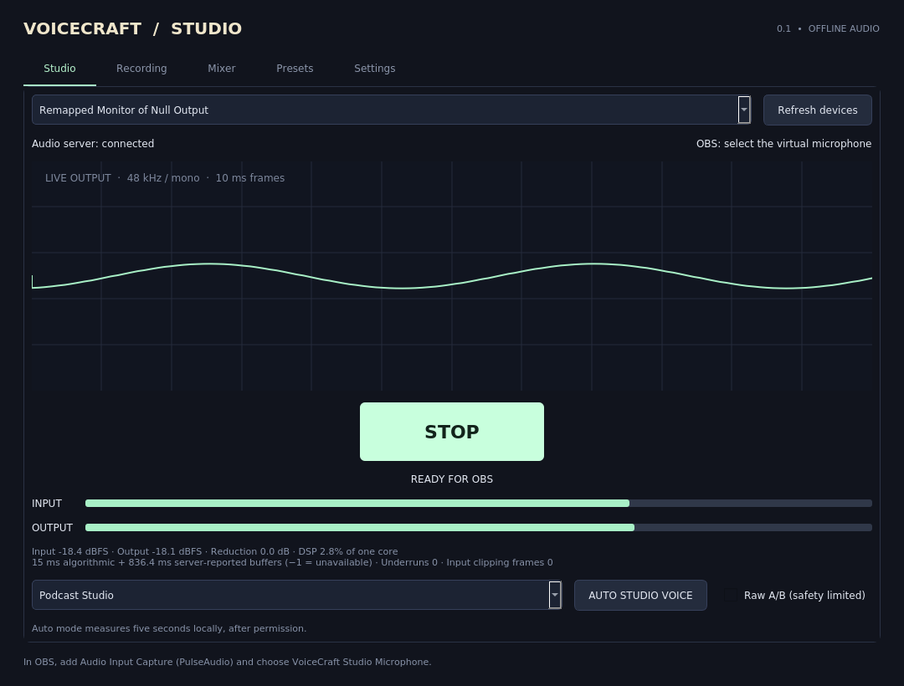

# VoiceCraft Studio

Native offline Linux microphone processing for OBS, with a Qt 5 desktop interface
and a C++17 audio engine. Repository name: **creative-studio-mic**.

**0.1.0 is an initial tested release, not a claim of production certification.**
Built and installed on Ubuntu 20.04 amd64. Real PulseAudio routing, OBS recording
using a synthetic microphone, local recording/edit/export and GUI tests are
included. Physical microphone quality, USB hotplug, target J1800 performance,
PipeWire desktops and hardware round-trip latency still require local testing.
See [verification evidence](VERIFICATION.md) and [the requested brief](docs/DEVELOPMENT_BRIEF.md).



## Install and connect OBS

Download `voicecraft-studio_0.1.0_amd64.deb` from Releases (or `dist/`), then:

```sh
sudo apt install ./voicecraft-studio_0.1.0_amd64.deb
voicecraft-studio
```

1. Use headphones. Select your physical microphone.
2. Click **START**. Wait for **READY FOR OBS**.
3. In OBS, add **Audio Input Capture (PulseAudio)** and choose
   **VoiceCraft Studio Microphone**.
4. Keep VoiceCraft Studio running. Click **STOP** when finished.

The system default microphone is never changed. No OBS configuration is edited.
OBS capture status checks whether OBS has an active source-output connected to
this instance's virtual source; it cannot inspect a sandboxed OBS instance that
cannot reach the same audio server. OBS monitoring should be off to avoid echo.

## What works

- PulseAudio 13-compatible virtual sink → remapped source routing at 48 kHz mono.
- Automatic retry for the exact selected device name after source/server failure.
  Use Refresh if a reconnected device receives a different source name.
- UUID-verified module cleanup, per-user instance lock and signal handling.
- High-pass → bundled RNNoise → expander → four-band corrective EQ → de-esser →
  soft-knee compressor → optional saturation → conservative optional gain assist
  → interpolated peak detector / lookahead limiter.
- Five voice presets plus custom controls, smoothed changes, input/output meters,
  waveform, clipping and underrun counters, DSP processing time and server timing.
- Explicitly consented five-second local signal analysis for conservative gate,
  rumble and clipping adjustments. It is not an AI speech-quality assessment.
- Aligned raw A/B with the output gain and safety limiter retained.
- Opt-in local raw/processed recording, pause/resume, waveform timeline with zoom,
  cursor, trim/split, undo/redo and raw/processed headphone preview.
- WAV 24-bit, FLAC and MP3 exports; mono or dual-mono stereo. Source is mono, so
  stereo export does not add stereo information. ffmpeg provides the codecs.
- Low CPU mode bypasses RNNoise while retaining tone/dynamics processing.

No cloud API, account, telemetry, runtime downloads, or GPU is used by the app.
Audio is local. Recording creates temporary files only after Record is clicked;
exported files remain where you save them. Temporary takes are deleted on normal
exit and may remain after a crash. Export before closing to preserve a take.

No echo cancellation, background-speaker isolation, room dereverberation,
certified BS.1770 meter, or guaranteed LUFS/true-peak result for arbitrary material
is claimed. The limiter includes a conservative margin; independent ffmpeg
oversampled peak measurements cover the supplied test signals.

## Develop on Ubuntu 20.04

```sh
sudo apt update
sudo apt install build-essential cmake pkg-config qtbase5-dev libpulse-dev \
  pulseaudio pulseaudio-utils xvfb xauth python3 python3-tk ffmpeg xdotool
./scripts/build-native.sh
python3 tests/measure_peaks.py
# Run as a normal user, not root:
python3 tests/integration_native.py
xvfb-run -a build-native/voicecraft-gui-test
./scripts/package-native.sh
```

For the OBS recording acceptance test, also install `obs-studio`, then run:

```sh
VC_TEST_OBS=1 VC_SOAK_SECONDS=180 python3 tests/integration_native.py
```

The integration tests start isolated user-level audio servers with synthetic
sources and clean up their processes. They do not require or replace the host
system audio service. GUI tests exercise actual recording, edits and all export
formats. Do not run the application as root.

For release builds use the pinned Ubuntu 20.04 container in
[the CI workflow](.github/workflows/release.yml). Do not distribute builds made on
newer distributions as verified Ubuntu 20.04 binaries. CMake's release build uses
portable CPU settings, not `-march=native`.

The original Creative Mic Python/C sources, tests, installers and documentation
are retained for reference; the new installer launches only the native Qt/C++
application. Legacy instructions are in [LEGACY_README.md](docs/LEGACY_README.md).

## Headless

```sh
voicecraft-studio --list-sources
voicecraft-studio --headless --source YOUR_EXACT_SOURCE_NAME
# Optional explicit local recording, float32 little-endian mono at 48 kHz:
voicecraft-studio --headless --source YOUR_EXACT_SOURCE_NAME --capture take.f32
```

Ctrl+C cleans up owned audio modules. The CLI refuses to overwrite an existing
capture file. `--low-cpu` bypasses neural suppression; `--dry` enables aligned A/B.
`--seconds N` is useful for diagnostics. Status appears on stderr and metrics as
JSON lines on stdout. Server buffer timing is not hardware round-trip latency.

## Guides and licensing

- [User guide](docs/USER_GUIDE.md)
- [OBS guide](docs/OBS_GUIDE.md)
- [Troubleshooting](docs/TROUBLESHOOTING.md)
- [Architecture and limitations](docs/ARCHITECTURE.md)
- [Test evidence](VERIFICATION.md)

Application code is MIT licensed. RNNoise v0.1 and its pretrained weights are
bundled unchanged under their BSD license (`vendor/rnnoise/COPYING`). Qt and
PulseAudio are dynamically linked system libraries; ffmpeg is a separate system
process. Their distribution licenses remain their own. No proprietary audio
service or model is included. The `.deb` does not bundle those system libraries.
